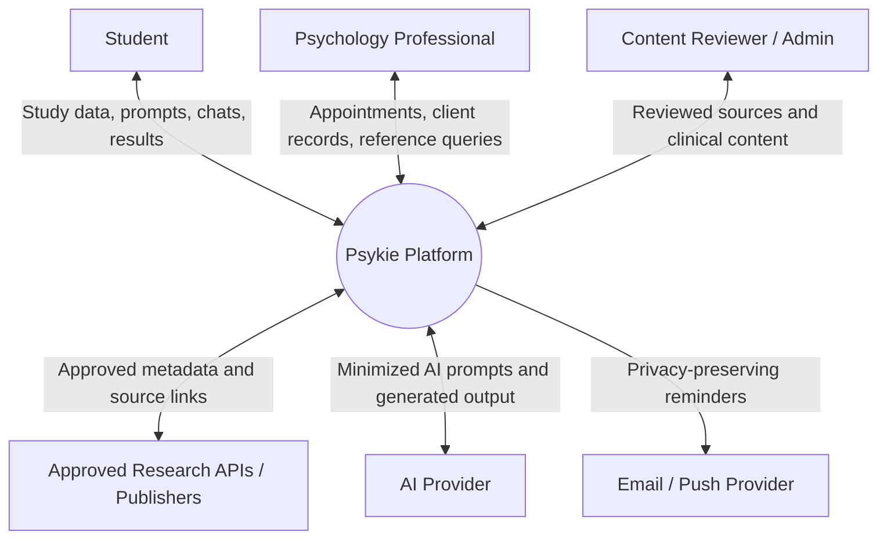
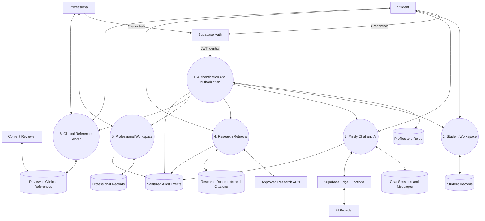
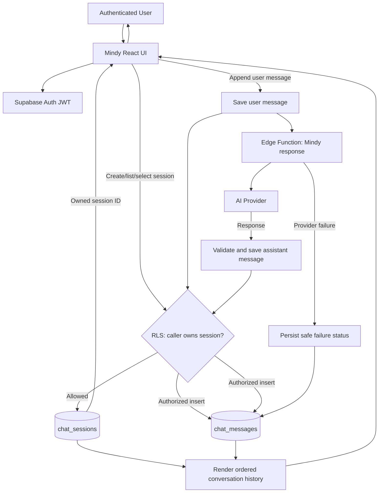
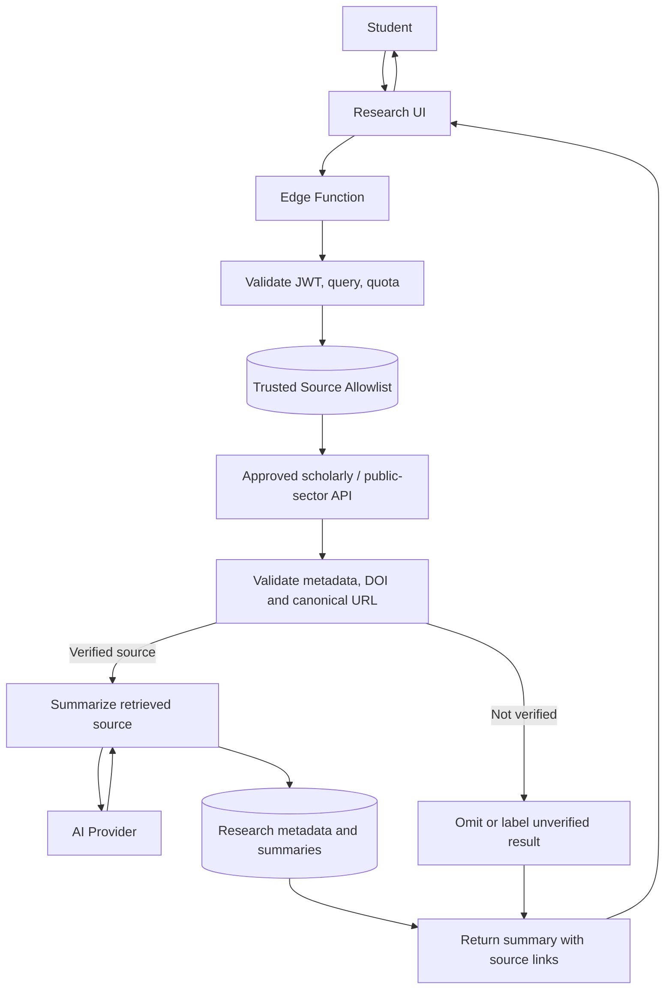
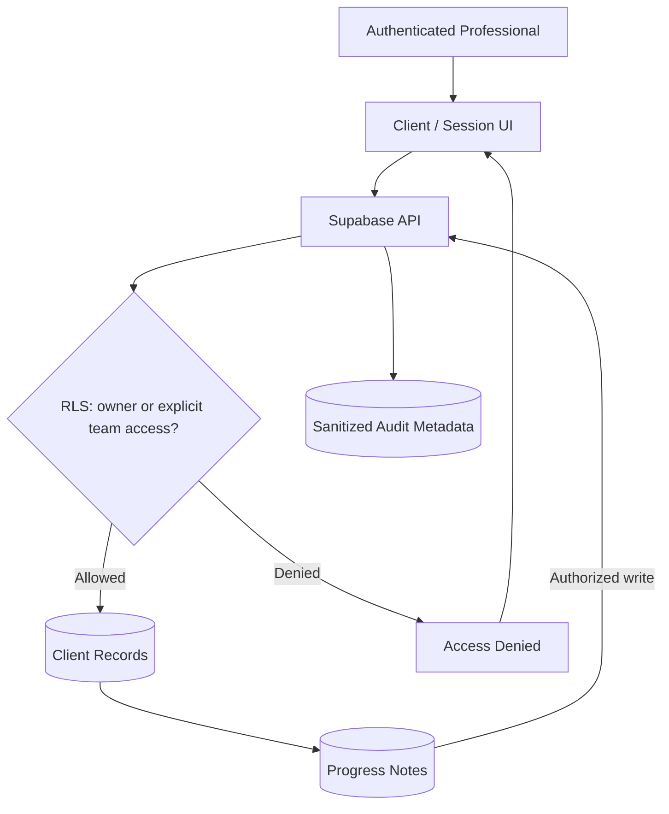

# Psykie — Data Flow Diagrams (DFD)

Diagrams are expressed in Mermaid inside Markdown for version control and easy editing.

## 1. Context / Level 0

## 2. Level 1 — Main data flows

## 3. Level 2 — Persisting Mindy chat history

Controls:
- A client-supplied session ID is never proof of ownership.
- Check ownership in RLS and in the trusted function.
- Save the user's message before AI generation so a failed call does not erase it.
- Save only user-visible assistant text and required citation/usage metadata; never hidden chain-of-thought.
- Paginate long histories and order by `created_at` plus a stable tie-breaker.
- Update the parent session's `updated_at` after a message is added.

## 4. Level 2 — Trusted research search

## 5. Level 2 — Professional note access

## 6. Data classification

| Classification | Examples | Controls |
|---|---|---|
| Public | Approved public links and educational summaries | Source validation and versioning |
| Personal | Profile, subjects, notes, chat history | Auth, owner-scoped RLS |
| Sensitive professional | Client profiles, progress notes, assessments | Strict relationship-based RLS, private storage, audit metadata, retention rules |
| Secrets | Service-role and AI-provider keys | Server-side secrets only |

## 7. Trust boundaries

1. Browser → Supabase API: authentication does not replace RLS.
2. Browser → Edge Function: validate identity, payload, quotas, and record access.
3. Edge Function → AI provider: minimize data and protect keys.
4. Research API → Psykie: treat returned content and URLs as untrusted until validated.
5. Professional records: require owner or explicit team relationship at database level.
