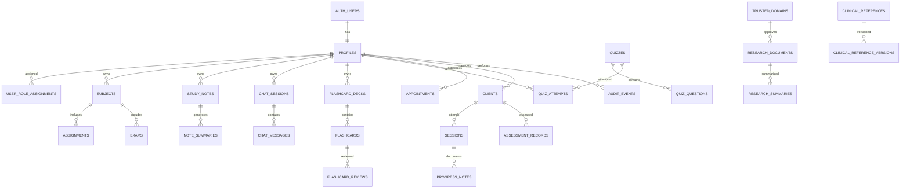

# Psykie — Entity Relationship Diagram (ERD)

**Database target:** Supabase PostgreSQL  
**Status:** Proposed logical model; validate and migrate incrementally.

## 1. Core ERD

`AUTH_USERS` is Supabase-managed `auth.users`; do not recreate it.

## 2. Core tables and suggested fields

### Identity
- `profiles`: `id UUID PK/FK auth.users.id`, `display_name`, `created_at`, `updated_at`.
- `user_role_assignments`: `id`, `user_id`, `role`, `assigned_by`, `created_at`. Role changes use a trusted administrative flow.

### Student workspace
- `subjects`: `id`, `owner_id`, `name`, `description`, `color`, timestamps.
- `assignments`: `id`, `owner_id`, `subject_id`, `title`, `description`, `due_at`, `status`, `priority`, timestamps.
- `exams`: `id`, `owner_id`, `subject_id`, `title`, `exam_at`, `notes`.
- `study_notes`: `id`, `owner_id`, `title`, `content`, `storage_path`, `mime_type`, `processing_status`, timestamps.
- `note_summaries`: `id`, `note_id`, `owner_id`, `summary`, `key_concepts JSONB`, `model_metadata JSONB`, `created_at`.

### AI chat history (required)
- `chat_sessions`:
  - `id UUID PK DEFAULT gen_random_uuid()`
  - `user_id UUID NOT NULL REFERENCES auth.users(id)`
  - `title TEXT NOT NULL DEFAULT 'New conversation'`
  - `chat_type TEXT NOT NULL DEFAULT 'general'` (e.g. general, study, research; constrain allowed values)
  - `created_at TIMESTAMPTZ NOT NULL DEFAULT now()`
  - `updated_at TIMESTAMPTZ NOT NULL DEFAULT now()`
  - `archived_at TIMESTAMPTZ NULL`
  - `metadata JSONB NOT NULL DEFAULT '{}'`
- `chat_messages`:
  - `id UUID PK DEFAULT gen_random_uuid()`
  - `session_id UUID NOT NULL REFERENCES chat_sessions(id) ON DELETE CASCADE`
  - `user_id UUID NOT NULL REFERENCES auth.users(id)` (denormalized for RLS/query performance; enforce consistency with session owner)
  - `role TEXT NOT NULL CHECK (role IN ('user','assistant','system','tool'))`
  - `content TEXT NOT NULL`
  - `status TEXT NOT NULL DEFAULT 'complete'` (e.g. pending, complete, failed)
  - `created_at TIMESTAMPTZ NOT NULL DEFAULT now()`
  - `model_name TEXT NULL`
  - `token_usage JSONB NULL`
  - `citations JSONB NOT NULL DEFAULT '[]'`
  - `error_code TEXT NULL` (safe code only, not secrets or raw provider errors)
- Do not store hidden chain-of-thought. Store only user-visible assistant output and necessary source/tool metadata.
- A database trigger or trusted server operation should update session `updated_at` whenever messages change.
- Ensure a message's `user_id` matches its parent session's `user_id` through constraints/triggers or by avoiding client-controlled duplicate ownership and writing via a trusted function.

### Flashcards, quizzes, board review
- `flashcard_decks`: `id`, `owner_id`, `title`, `subject_id`, `source_note_id`, timestamps.
- `flashcards`: `id`, `deck_id`, `front`, `back`, `tags TEXT[]`, `source_metadata JSONB`, timestamps.
- `flashcard_reviews`: `id`, `user_id`, `flashcard_id`, `rating`, `reviewed_at`, `next_review_at`, `interval_days`, `algorithm_state JSONB`.
- `quizzes`: `id`, `owner_id` nullable for reviewed shared quizzes, `title`, `topic`, `source_type`, `created_at`.
- `quiz_questions`: `id`, `quiz_id`, `prompt`, `options JSONB`, `answer_key JSONB`, `explanation`, `position`. Protect answer keys from being exposed before submission.
- `quiz_attempts`: `id`, `quiz_id`, `user_id`, `started_at`, `submitted_at`, `score`, `answers JSONB`.

### Research and trusted sources
- `trusted_domains`: `id`, `domain`, `source_category`, `status`, `reviewed_by`, `reviewed_at`.
- `research_documents`: `id`, `title`, `authors JSONB`, `publication_date`, `doi`, `canonical_url`, `source_domain_id`, `abstract`, `source_type`, `license_notes`, `verified_at`.
- `research_summaries`: `id`, `user_id`, `document_id`, `summary`, `claim_sources JSONB`, `model_metadata JSONB`, `created_at`.
- `citations`: `id`, `document_id`, `style`, `rendered_text`, `style_version`, `created_at`.

### Professional workspace
- `clients`: `id`, `owner_professional_id`, minimum necessary profile fields, timestamps.
- `appointments`: `id`, `professional_id`, `client_id` nullable where appropriate, `starts_at`, `ends_at`, `timezone`, `status`, `reminder_settings JSONB`, timestamps.
- `sessions`: `id`, `professional_id`, `client_id`, `appointment_id` nullable, `session_at`, `session_type`, timestamps.
- `progress_notes`: `id`, `session_id`, `client_id`, `author_professional_id`, `content`, timestamps, `access_classification`.
- `assessment_records`: `id`, `client_id`, `professional_id`, `instrument_name`, `instrument_version`, `scores JSONB`, `interpretation_notes`, `assessed_at`.
- `audit_events`: `id`, `actor_id`, `action`, `record_type`, `record_id`, `occurred_at`, `safe_metadata JSONB`. Do not store note content or secrets in audit metadata.

### Clinical reference content
- `clinical_references`: `id`, `slug`, `title`, `category`, `content_type`, `status`.
- `clinical_reference_versions`: `id`, `reference_id`, `version_label`, `summary_content`, `source_url`, `source_identifier`, `license_notes`, `reviewed_by`, `reviewed_at`, `published_at`.

## 3. Important relationships and constraints

- All user-owned rows must have an owner relationship.
- Use foreign keys and deliberate delete behavior; clinical records may need controlled retention rather than cascade deletion.
- Enforce `starts_at < ends_at`, valid status values, and nonnegative review intervals.
- Use unique normalized domains and DOI constraints where appropriate.
- Index `assignments(owner_id, due_at)`, `exams(owner_id, exam_at)`, `chat_sessions(user_id, updated_at DESC)`, `chat_messages(session_id, created_at)`, `flashcard_reviews(user_id, next_review_at)`, `appointments(professional_id, starts_at)`, `sessions(client_id, session_at DESC)`.
- Add full-text indexes to approved research metadata and clinical summaries as needed.
- Ensure quiz answer keys cannot be read before an attempt is submitted if the product requires that protection.

## 4. RLS policy intent

- `chat_sessions`: authenticated owner may select/insert/update/delete only rows where `user_id = auth.uid()`.
- `chat_messages`: authorize through the parent session owner; do not trust a caller-supplied `user_id` alone. Ensure session and message ownership always agree.
- Student records: owner-only policies.
- Client records: professional owner or explicit care-team membership only.
- Clinical reference tables: public read only for approved/published entries; writes restricted to reviewers/admins.
- Trusted-domain allowlist and role assignments: privileged write access only.
- Private Storage: verify both authenticated identity and authorized record relationship.

These are policy requirements, not ready-to-run SQL. Test `SELECT`, `INSERT`, `UPDATE`, and `DELETE` with separate accounts before production.
