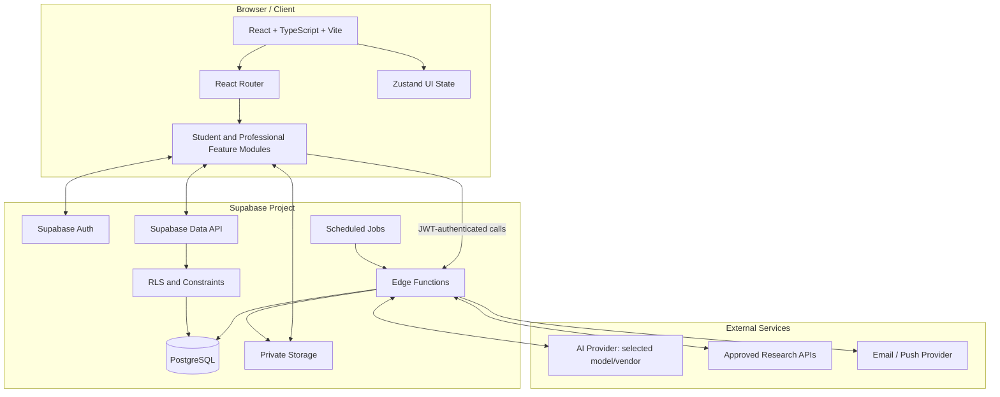

# Psykie — System Architecture

## 1. Current baseline from uploaded ZIP

The source archive contains a React + TypeScript + Vite frontend, React Router, Zustand, pages for Dashboard, Mindy, Notes, Flashcards, Quizzes, Research, Calendar, Clients, Documents, Settings, Help, Login, and Register.

Findings relevant to implementation:
- `src/store/useAuthStore.ts` uses mock users and Zustand persistence; it is not Supabase Auth.
- `src/store/useMindyStore.ts` stores sessions/messages in in-memory Zustand state and uses a hard-coded `current-user` identifier.
- `src/pages/MindyPage.tsx` calls `generateMindyResponse`, which produces predefined template responses.
- `src/utils/aiGenerator.ts` contains sample/template note, flashcard, quiz, and research-generation logic.
- The route/page presence does not prove end-to-end persistence or live provider integration.

Use the current UI as a foundation. Replace mock services incrementally behind typed data/service boundaries.

## 2. Target architecture



## 3. Responsibilities

### Frontend
- Keep route-level screens and design where healthy.
- Use Supabase client for authenticated operations protected by RLS.
- Use Zustand for transient UI state, not as the sole source of truth for persisted records.
- Display chat loading, retry, failure, and history states.
- Never include service-role or AI provider keys in browser code.
- Treat route guards as UX only; backend/database enforce access.

### Supabase Auth
- Registration, login, logout, recovery, and sessions.
- JWT identity for RLS and Edge Functions.
- Profile creation through a trusted flow.
- Role changes restricted to privileged administration.

### PostgreSQL and RLS
- Persist profiles, student data, chat sessions/messages, research metadata, appointments, and professional records.
- Enforce ownership/relationship rules.
- Use migrations, constraints, indexes, and tested delete semantics.
- Protect quiz answer keys and clinical records.

### Storage
- Private buckets for uploaded notes and authorized files.
- Validate file types, sizes, and processing status.
- Store object paths, not public URLs, for private files.

### Edge Functions
- AI-provider proxy and output validation.
- Research source retrieval and citation validation.
- Document-processing orchestration.
- Reminder orchestration and other privileged operations.
- Enforce identity, ownership, quotas, and payload limits.

## 4. Mindy chat request flow

1. User authenticates through Supabase Auth.
2. UI loads `chat_sessions` owned by the user, ordered by `updated_at DESC`.
3. Selecting a session loads its `chat_messages` in chronological order.
4. On send, the app persists the user message and pending state.
5. The client calls an Edge Function with the session ID and prompt.
6. The function validates JWT, session ownership, quota, and input size.
7. The function calls the configured AI provider using server-side secrets.
8. The response is validated and persisted as an assistant message, including source citations when applicable.
9. The session's `updated_at` is refreshed and UI updates.
10. On failure, the prompt remains visible and the message receives a safe failed/retryable state.

Use idempotency/request IDs where retries could create duplicate messages. Avoid storing hidden chain-of-thought. Keep chat history private under RLS.

## 5. Suggested project structure

```text
Psykie/
├── public/
├── src/
│   ├── app/
│   │   ├── App.tsx
│   │   ├── router.tsx
│   │   └── route-guards/
│   ├── components/
│   │   ├── ui/
│   │   ├── layout/
│   │   └── feedback/
│   ├── features/
│   │   ├── auth/
│   │   ├── dashboard/
│   │   ├── subjects/
│   │   ├── assignments/
│   │   ├── exams/
│   │   ├── mindy-chat/
│   │   ├── notes/
│   │   ├── flashcards/
│   │   ├── board-review/
│   │   ├── research/
│   │   ├── calendar/
│   │   ├── clients/
│   │   ├── assessments/
│   │   ├── diagnostic-references/
│   │   └── therapy-resources/
│   ├── lib/
│   │   ├── supabase/client.ts
│   │   ├── supabase/database.types.ts
│   │   ├── env.ts
│   │   └── validation/
│   ├── services/
│   ├── hooks/
│   ├── stores/
│   ├── types/
│   ├── utils/
│   └── main.tsx
├── supabase/
│   ├── config.toml
│   ├── migrations/
│   ├── seed.sql
│   ├── functions/
│   │   ├── mindy-chat/
│   │   ├── generate-quiz/
│   │   ├── summarize-notes/
│   │   ├── research-search/
│   │   ├── summarize-research/
│   │   └── send-reminders/
│   └── tests/
│       ├── rls/
│       └── functions/
├── tests/
│   ├── unit/
│   ├── integration/
│   └── e2e/
├── .env.example
├── package.json
└── README.md
```

This is a target structure, not a command to move all current files immediately. Map imports and tests first; migrate feature by feature.

## 6. Environment and deployment

- Browser variables may include Supabase URL and publishable/anon key; these are public configuration values and depend on RLS for safety.
- AI keys, service-role keys, and privileged credentials must be stored only in server-side secret management.
- Use separate development/test/production projects.
- Apply schema changes through versioned migrations.
- Keep secrets out of `.env.example`, frontend bundles, logs, and source control.

## 7. Architecture decisions to finalize

- AI provider and model selection.
- Research APIs and source allowlist.
- File types, size limits, OCR/document parsing.
- Individual professional ownership or care-team sharing.
- Reminder channel and timezone handling.
- Whether professional client records are in MVP or a later restricted release.
- Licensing for DSM-related and assessment content.
- Applicable privacy and health-data requirements.
